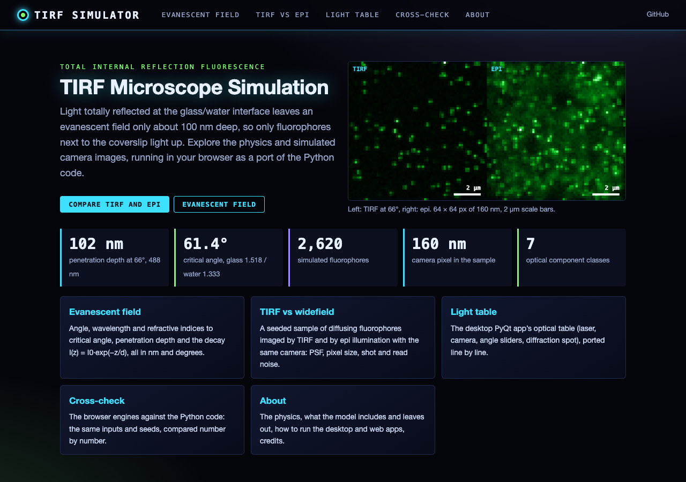
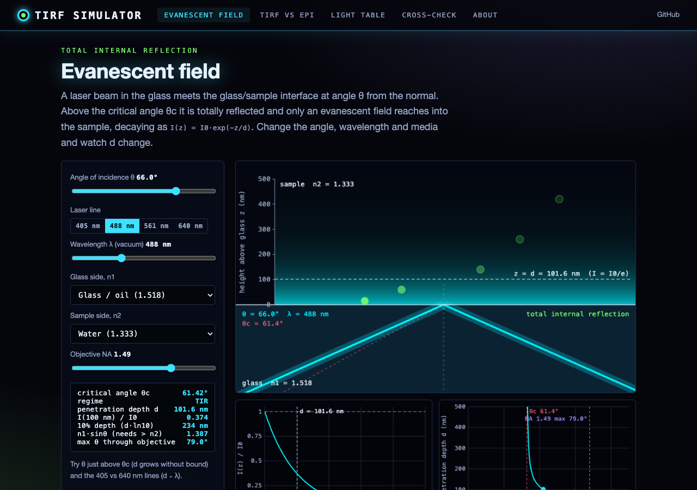
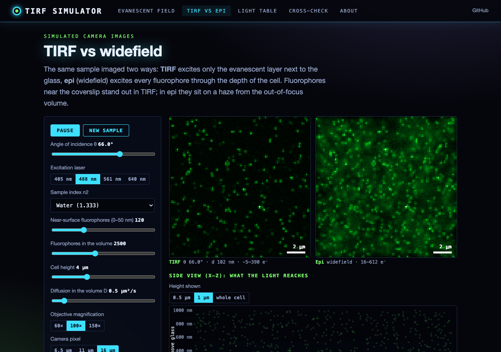
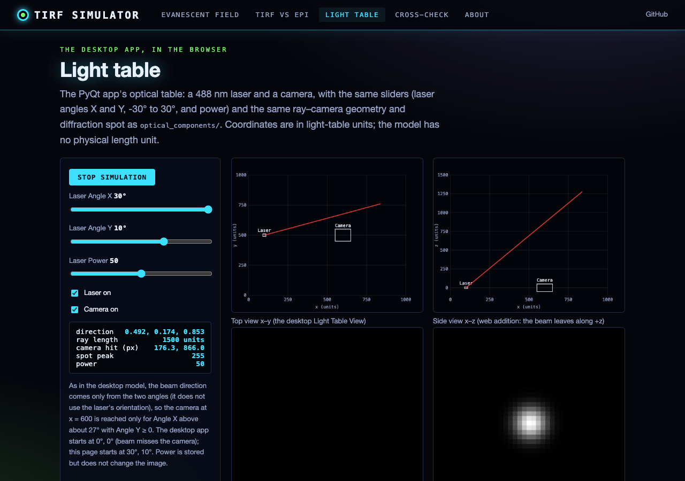

# TIRF Microscope Simulation

## Introduction

This project simulates a Total Internal Reflection Fluorescence (TIRF) microscope, providing an interactive platform for users to understand and explore the principles of TIRF microscopy. The simulation includes a virtual optical table with adjustable components such as lasers, lenses, and a camera, allowing users to visualize the light path and resulting images in real-time.

## Table of Contents

1. [Installation](#installation)
2. [Usage](#usage)
3. [Components](#components)
4. [TIRF Microscopy Overview](#tirf-microscopy-overview)
5. [Mathematical Principles](#mathematical-principles)
6. [Methods Used in the Simulation](#methods-used-in-the-simulation)
7. [Web interface and static site](#web-interface-and-static-site)
8. [Contributing](#contributing)
9. [License](#license)

## Installation

To run the TIRF microscope simulation, follow these steps:

1. Clone the repository:
git clone https://github.com/gddickinson/tirf_microscope_simulation.git

2. Navigate to the project directory:
cd tirf_microscope_simulation

3. Install the required dependencies (numpy, scipy, PyQt5, pyqtgraph):
pip install -r requirements.txt

## Usage

To start the simulation:

1. Run the main script:
python main.py

2. The GUI will open, displaying the light table view, camera view, and control panel.

3. Press "Start Simulation", then use the sliders in the control panel to adjust the laser angles and power.
   With the default layout the beam reaches the camera only for Laser Angle X above about 27° and
   Laser Angle Y of 0° or more; the power value is stored but does not yet change the camera image.

4. Toggle components on/off using the checkboxes in the component list.

5. Observe the changes in the light table view and the resulting camera image.

## Components

The simulation includes the following components:

- **Laser**: Emits a beam of light with adjustable angle and power.
- **Lenses**: Refract the light beam.
- **Camera**: Captures the resulting image from the light interaction.
- **Optical Table**: Displays the layout of components and the light path.

## TIRF Microscopy Overview

Total Internal Reflection Fluorescence (TIRF) microscopy is an advanced imaging technique used to observe fluorescent molecules near a surface with high contrast and low background noise.

Key principles of TIRF microscopy:

1. **Total Internal Reflection**: When light travels from a medium with a higher refractive index (e.g., glass) to one with a lower refractive index (e.g., water), it can be totally reflected at the interface if the angle of incidence is greater than the critical angle.

2. **Evanescent Wave**: During total internal reflection, a thin electromagnetic field (evanescent wave) penetrates a short distance into the lower refractive index medium. This field can excite fluorophores within ~100-200 nm of the interface.

3. **Selective Excitation**: Only fluorophores within the evanescent field are excited, resulting in low background fluorescence and high signal-to-noise ratio.

4. **Applications**: TIRF microscopy is widely used in cell biology to study processes occurring near the cell membrane, such as exocytosis, endocytosis, and membrane protein dynamics.

## Mathematical Principles

The simulation incorporates several mathematical concepts (implemented in `physics/tirf_optics.py`):

1. **Snell's Law**: Describes the relationship between the angles of incidence and refraction for light passing through different media.
n1 * sin(θ1) = n2 * sin(θ2)
Where n1 and n2 are the refractive indices of the two media, and θ1 and θ2 are the angles of incidence and refraction, respectively.

2. **Critical Angle**: The angle of incidence above which total internal reflection occurs.
θc = arcsin(n2 / n1)
Where n1 > n2.

3. **Evanescent Wave Intensity**: The intensity of the evanescent wave decays exponentially with distance from the interface.
I(z) = I0 * e^(-z/d)
Where I0 is the intensity at the interface, z is the distance from the interface, and d is the penetration depth.

4. **Penetration Depth**: The distance at which the evanescent wave intensity falls to 1/e of its value at the interface.
d = λ / (4π * sqrt(n1^2 * sin^2(θ) - n2^2))
Where λ is the wavelength of the light in vacuum, and θ is the angle of incidence.

## Methods Used in the Simulation

The simulation employs various computational methods to model the TIRF microscope:

1. **Ray Tracing**: Simulates the path of light through the system by tracing rays from the laser source through various optical components.

2. **Vector Mathematics**: Used for calculating ray directions, reflections, and refractions.

3. **Intersection Algorithms**: Determine where rays intersect with optical components and the camera sensor.

4. **Gaussian Beam Approximation** (planned, not implemented yet): the laser is currently traced as a single ray.

5. **Image Formation**: Simulates the camera sensor's response to incident light, including effects like diffraction-limited spots.

6. **GUI Rendering**: Uses PyQt and PyQtGraph for real-time visualization of the optical table and camera image.

## Web interface and static site

A web version runs the TIRF physics and simulated images in the browser:
**https://gddickinson.github.io/tirf_microscope_simulation/** (published from `main` by GitHub Pages).

| Home | Evanescent field |
|---|---|
|  |  |
| **TIRF vs widefield** | **Light table (desktop model)** |
|  |  |

- **Evanescent field**: angle of incidence (°), wavelength (nm) and refractive indices to critical angle,
  penetration depth d (nm) and I(z) = I0·exp(−z/d), using the formulas below (`physics/tirf_optics.py`).
- **TIRF vs widefield**: a seeded sample of diffusing fluorophores imaged by TIRF and epi illumination with the same
  camera (Gaussian PSF, pixel size = camera pixel / magnification, default 16 µm / 100× = 160 nm; Poisson and read
  noise), from `physics/tirf_imaging.py`.
- **Light table**: the desktop app's laser/camera model, ported line by line.
- **Cross-check**: the JavaScript engines against the Python code on the same inputs and seeds.

Run the web app locally (FastAPI, http://127.0.0.1:8203):

    pip install -r requirements-web.txt
    python run_web.py

Tests: `python -m pytest -q tests/` (the web tests also run the node test `web/static/tirf_engine.test.mjs`, which
compares the JS engines with `tests/fixtures/engine_fixture.json`; regenerate it with
`python scripts/make_engine_fixture.py`). Build the static site with `python scripts/build_static.py`.

## Contributing

Contributions to improve the simulation are welcome. Please follow these steps:

1. Fork the repository.
2. Create a new branch for your feature.
3. Commit your changes.
4. Push to your branch.
5. Create a pull request.

## License

This project is licensed under the MIT License - see the [LICENSE](LICENSE) file for details.
